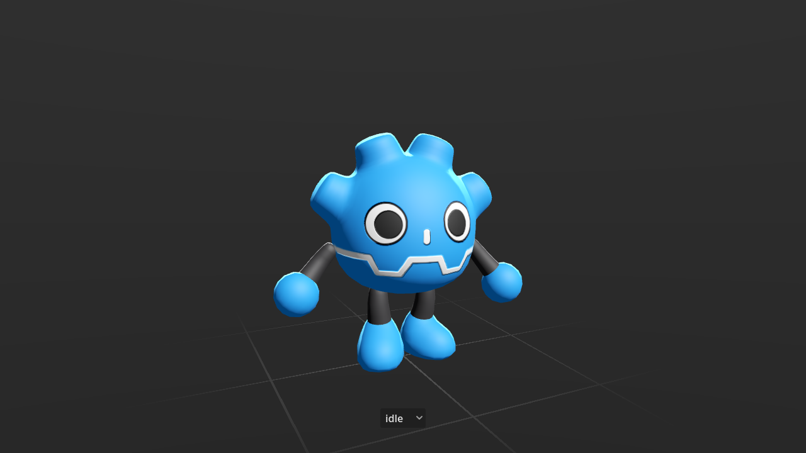

# Godot Plush Character
A fun, energetic character for your Godot project

### What's inside the project

- Character model weighting a few Ko.
- Basic character controller with platformer movement
	- Physic based
	- Parametric jump height
- Basic Animations
	- Idle
	- Walk
	- Run
	- Jump / Fall
	- Wave
- Ragdoll mode

### Credits

Demo Audio: [Kenney](https://kenney.nl/assets/category:Audio?sort=update)

### Used In
Projects using the Godot plush model.

[Godot Multiplayer video](https://www.youtube.com/watch?v=jff9oxO8v1s) by [Andrew Davis](https://jonandrewdavis.com/)

[Godot State Machine Third Person Controller](https://github.com/Jeh3no/Godot-State-Machine-Third-Person-Controller) by [Jeh3no](https://github.com/Jeh3no)
